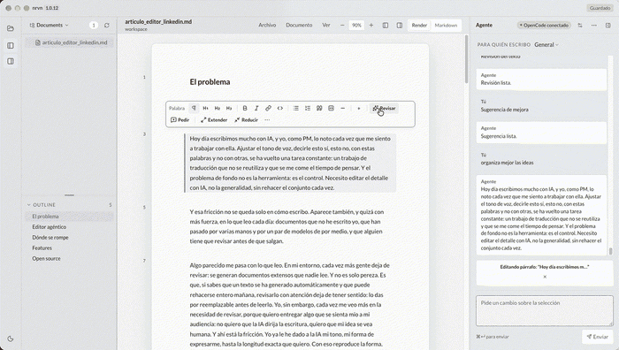
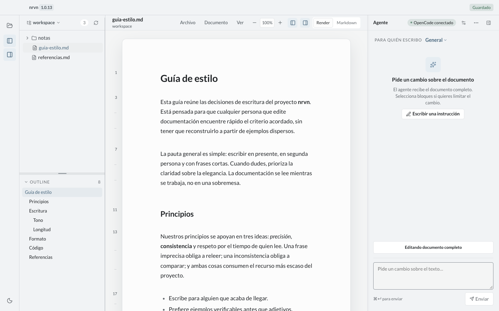
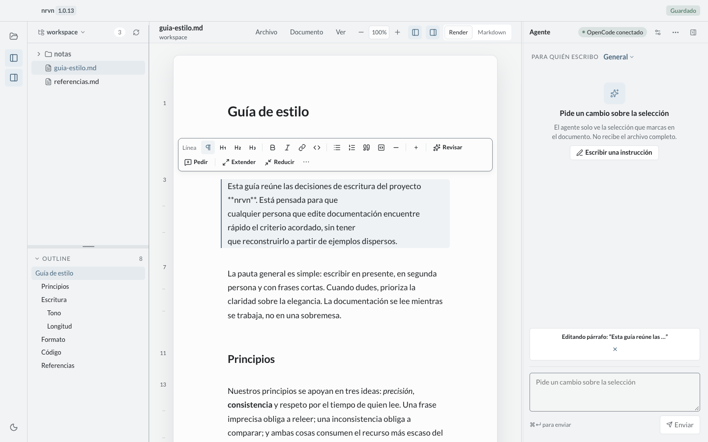
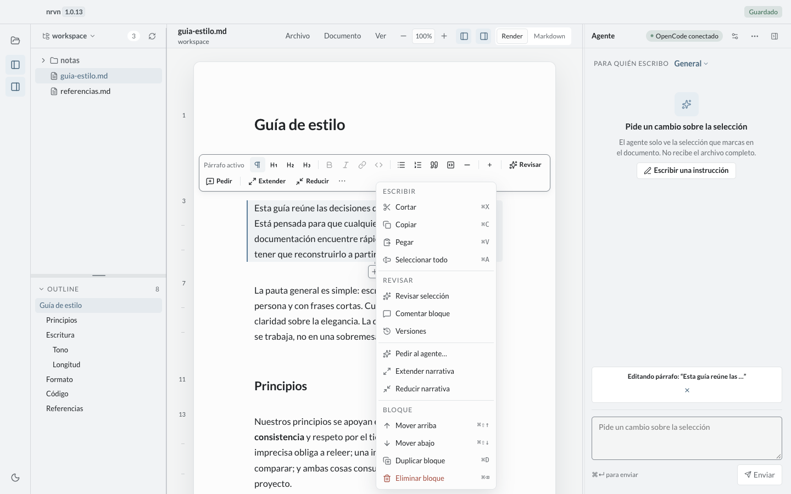
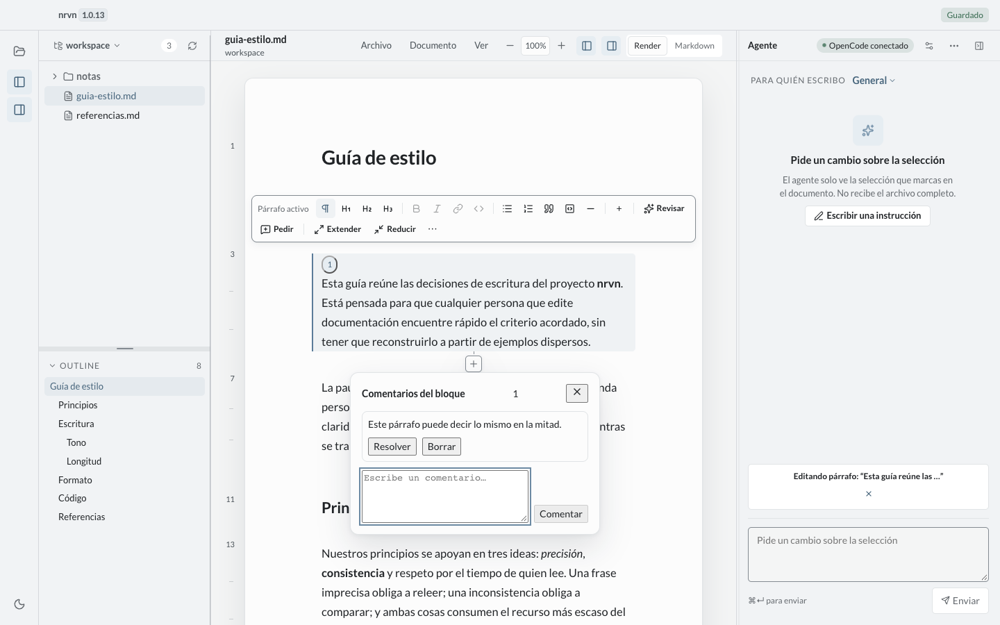
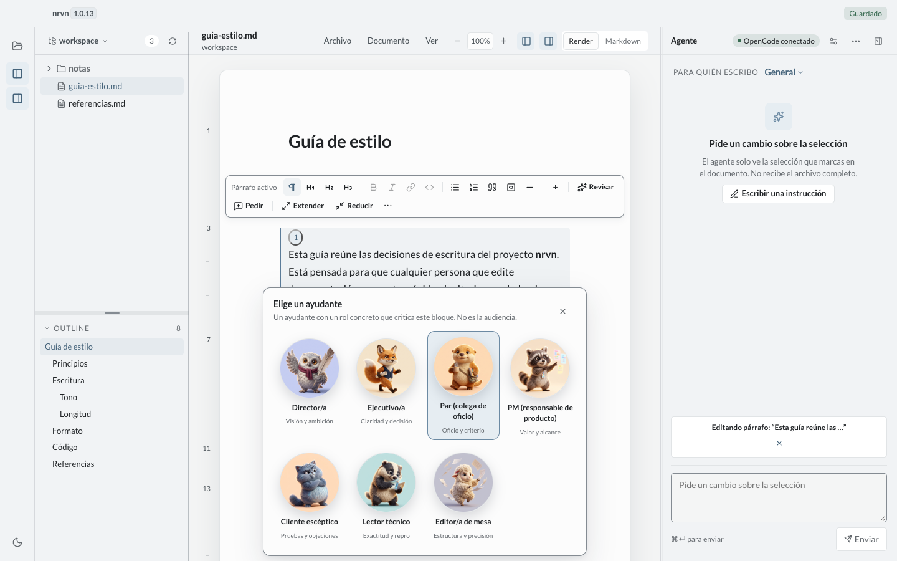
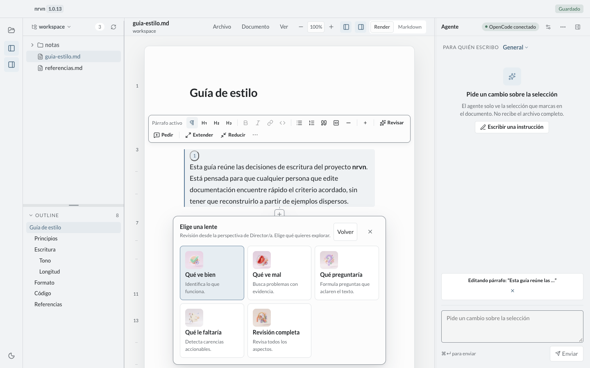
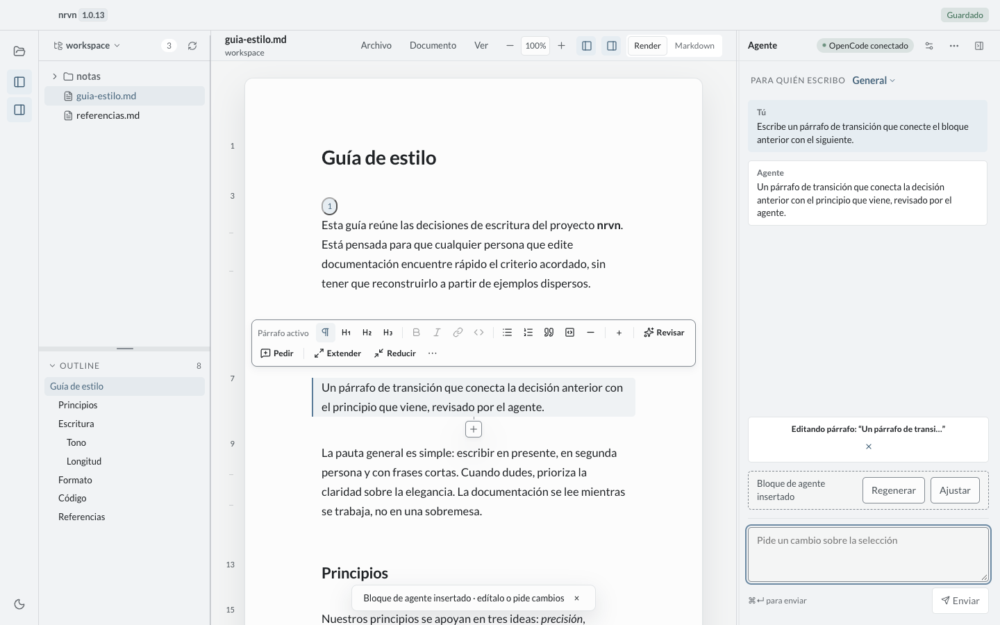
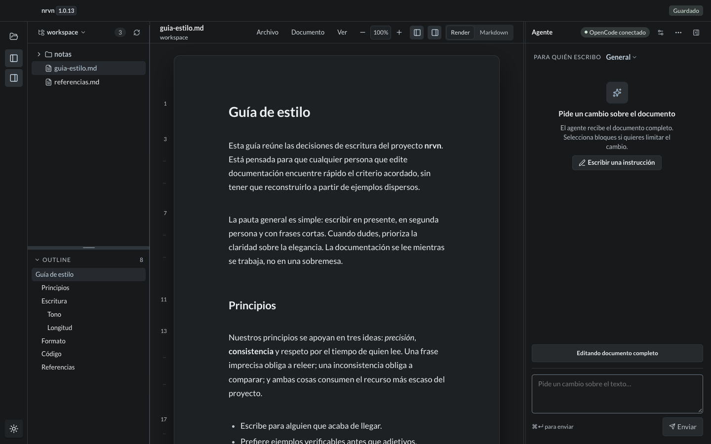

# nrvn

[English](README.md) | [Español](README.es.md)

Editor local de Markdown con agentes, para macOS.

Abre una carpeta, lee tus documentos con tipografía editorial, selecciona un bloque y pide a un
agente que lo reescriba. El agente **propone**; tú decides. Nada se aplica solo y nada sale de tu
máquina salvo la petición al proveedor de modelo que tú elijas.

<p align="center">
  
</p>

> **Estado: v1.0.13, 2026-11-05.** La app incluye edición Render/Markdown,
> selección, propuestas OpenCode con diff, operaciones inline en Render, comentarios/críticas,
> copias por idioma y metadatos `.nrvn`. Firma/notarización Apple, Windows/Linux, auto-update, i18n
> completa de UI, auditoría AA formal y sync siguen fuera de alcance de esta candidata.
> Ver [Honestidad](#honestidad).

## Propósito y visión

`nrvn` nace de un problema real de PMs y escritores que redactan documentos con IA: las
herramientas actuales son chat suelto o editores que reescriben todo. Falta un editor que permita
**iterar documentos por partes, preservando la voz y el contexto**, y convertir las correcciones
repetidas en reglas reutilizables.

Pero la visión no es "escribir más rápido". Es **poder revisar sin rendirse**: que un documento
asistido por IA siga siendo legible, discutible y defendible como propio. nrvn existe para reducir
la fricción de revisar y preservar las decisiones humanas, no para producir dumps de contenido
generado. El posicionamiento completo está en
[`docs/editor-agentico.md`](docs/editor-agentico.md) ([English](docs/editor-agentico.en.md)); la
priorización, en [`ROADMAP.md`](ROADMAP.md) ([English](ROADMAP.en.md)).

La intención del producto descansa en unos pocos principios. Describen la visión, no el estado
actual: lo implementado y lo pendiente se separa en [Honestidad](#honestidad).

- **Iteración aislada.** Se trabaja sobre un bloque, una sección o un rango. El agente solo
  recibe esa selección y solo puede tocar esa selección. El documento completo se envía solo
  cuando el usuario lo selecciona explícitamente.
- **Voz y tono persistentes.** Cada espacio/documento tiene un perfil de voz (registro, persona,
  longitud, léxico, cosas a evitar, ejemplos) que el agente usa como contexto de estilo,
  separado del contenido.
- **Memoria de área.** Cada bloque o sección guarda las decisiones humanas, las instrucciones y el
  "por qué está así"; esa memoria viaja con el área y sobrevive a la siguiente edición.
- **Procedencia.** Saber qué escribió una persona, qué generó un agente y qué se aceptó forma
  parte del documento; nunca se simula autoría humana.
- **Sesiones de foco.** El escritor puede centrarse en un área (p. ej. "Introducción") durante un
  tiempo, iterar hasta que esté bien y cerrarla. El historial queda asociado a ese bloque o
  sección.
- **Bandeja de guidelines.** Cada instrucción útil ("no uses adverbios", "frases de máximo 20
  palabras") se captura. Cuando hay suficientes, se **resumen en un bloque de reglas** y se
  pueden aplicar a todo el documento.
- **Refactor de consistencia.** Aplicar las reglas consolidadas a los bloques que no se editaron
  a mano, siempre como propuestas con diff, nunca automáticamente.
- **Versionado (roadmap).** El historial por bloque y de documento no está implementado.
- **Comentarios anclados.** Revisión por elementos, con hilo y resolución.
- **Local-first y control.** Ficheros en disco, metadatos en Application Support, propuestas que
  el usuario acepta, agente sin tools.

## Honestidad

- **Herramienta personal, open source, construida al 100 % con IA.** nrvn no es un producto
  de empresa ni tiene soporte. Es una herramienta que su autor necesita, publicada con la
  licencia MIT para quien quiera usarla, auditarla o mejorarla. Esa advertencia es
  explícita: el código y la documentación se han producido con IA y deben revisarse como tales.
- **La IA acelera, pero puede erosionar la confianza y la autoría.** nrvn existe para mantener el
  control humano de la narrativa, no para cederlo ni para producir documentos que nadie lee.
- **No elimina el sesgo ni garantiza calidad.** Reduce fricción y preserva decisiones; la revisión
  final sigue siendo humana.
- **Implementado no es visión.** Hoy hay editor, selección, agente, propuestas y conectores. La
  memoria de área, el bloqueo humano, el contexto conceptual, la generación multi-fuente, la
  procedencia exportable y la revisión de riesgos son visión, no estado. El detalle honesto está en
  [`docs/editor-agentico.md#5-honestidad-y-límites`](docs/editor-agentico.md#5-honestidad-y-límites).

## El artículo

**[El editor agéntico](docs/editor-agentico.md)** ([English version](docs/editor-agentico.en.md))
es el texto largo que hay detrás de nrvn: por qué escribir con IA falla en el control más que en la
calidad, qué necesita un agente para convertirse en un socio de escritura y dónde se rompe todavía
la versión actual.

> Últimamente escribimos mucho con IA. Ajustar el tono, decir sí a esto y no a aquello, es trabajo
> de traducción que no se reutiliza y se come el tiempo que tengo para pensar. El problema no es la
> herramienta: es el control — editar el detalle sin rehacerlo todo cada vez.
>
> La IA reproduce mi forma. Pero la forma no es la idea: escribe como yo y aun así no dice lo que
> quería, porque no tiene el contexto de decisión que hay detrás de cada párrafo.

El artículo explica también el modelo sobre el que está construido el editor: el documento como
árbol de nodos, el contexto guardado por bloque, el agente recibiendo solo el nodo seleccionado y
las ediciones humanas que sobreviven a la siguiente iteración.

## El problema

- **Fricción de herramientas.** Los editores Markdown que se leen bien se editan mal, y los que
  se editan bien imponen una vista de código que rompe la lectura.
- **Asistentes de IA invasivos.** La mayoría de herramientas de escritura con IA trabajan a nivel
  de documento completo o de chat suelto: copias y pegas, pierdes el contexto de *qué* estás
  reescribiendo y no tienes control granular.
- **Contexto perdido.** Las conversaciones sobre un documento no quedan asociadas a él; al
  reabrir el archivo se empieza de cero.
- **Voz perdida.** Regenerar un documento completo aplana el registro del autor y las decisiones
  ya tomadas.
- **Anotaciones huérfanas.** Los comentarios y revisiones viven en otro sitio, o como sidecars que
  ensucian el repositorio del usuario.

## Para quién es

| Segmento | Descripción | Necesidad dominante |
| --- | --- | --- |
| **PM / escritor que redacta con IA** | Escribe briefs, PRDs, entrevistas y ensayos en Markdown. | Mejorar la redacción por partes sin perder voz ni control. |
| **Editor técnico** | Escribe docs, RFCs y notas de arquitectura en un repo local. | Reescribir secciones con precisión sin romper formato ni historial. |
| **Revisor** | Revisa el documento de otra persona y deja feedback anclado. | Comentar por elemento con hilo y resolución. |
| **Usuario de OpenCode** | Ya tiene modelos configurados. | Una superficie de edición que reutilice esa configuración. |

## El flujo en tres pasos

```
1. SELECCIONA            2. PIDE                     3. ACEPTA
┌──────────────────┐     ┌──────────────────┐       ┌──────────────────┐
│ clic en párrafo  │     │ "más conciso,    │       │ diff antes/después│
│ clic en heading  │ ──▶ │  conserva el 40%"│ ────▶ │ Aceptar           │
│ Shift + clic     │     │ Cmd+Enter        │       │ Rechazar          │
└──────────────────┘     └──────────────────┘       │ Pedir cambios     │
                                                     └──────────────────┘
```

1. **Selecciona.** Clic en un párrafo selecciona ese bloque. Clic en un heading selecciona la
   sección completa hasta el siguiente heading de nivel igual o superior. Shift + clic extiende a
   un rango contiguo. Esc limpia. *(Implementado.)*
2. **Pide.** El panel derecho trabaja sobre la selección o sobre el documento completo cuando lo
   pides de forma explícita: recibe el archivo, la ruta de headings y el texto del contexto, nada
   más. El chip de contexto indica si trabajas sobre `Documento completo` o sobre una selección.
   *(Implementado y en validación.)*
3. **Acepta.** La respuesta se parsea y se muestra como diff por bloque o como propuesta de
   documento. Aceptar aplica exactamente ese reemplazo; Rechazar no toca el documento. *(En
   validación: el contrato de documento completo aún no se ha probado con un agente real.)*

## Conceptos clave

| Concepto | Qué es | Estado |
| --- | --- | --- |
| **Selección** | Bloque, sección, rango contiguo o documento completo seleccionado explícitamente. La unidad de trabajo. | Implementado |
| **Memoria de área** | Decisiones e instrucciones guardadas por bloque o sección, con su "por qué". | Visión (roadmap EA) |
| **Perfil de voz** | Contexto de estilo por documento: registro, persona, longitud, léxico, lista de cosas a evitar, ejemplos. | Previsto v0.2 |
| **Sesión de foco** | Área de trabajo acotada en el tiempo ("Introducción") con su propio historial. | Previsto v0.2 |
| **Bandeja de guidelines** | Instrucciones capturadas que se convierten en un bloque de reglas resumido. | No implementado |
| **Versión** | Historial navegable por bloque con procedencia y restauración como versión nueva. | Pendiente |
| **Propuesta** | Un diff que el usuario acepta, rechaza o pide cambiar. Nunca se aplica solo. | En validación |

## Features: actuales vs roadmap

| Área | Actual (v1.0.13) | No incluido / posterior |
| --- | --- | --- |
| Shell y workspace | Electron, árbol y outline, About | Windows/Linux, git |
| Editor | Render/Markdown, edición/formato inline, inserción, operaciones de bloque | — |
| Agente/revisión | OpenCode, propuestas con diff, presets, audiencias/personas, críticas y comentarios anclados, variante desde revisión | Las variantes libres por ejes son roadmap |
| Metadatos/idiomas | Sidecar `.nrvn` `<documento>.md.nrvn`, import/export y copias por idioma | Sync |
| Apariencia | Temas claro/oscuro, fuentes, tamaños Carta/A4/Ancha/Web | Auditoría AA formal |
| Plataforma | macOS arm64; instalador | Firma/notarización, auto-update |

## Recorrido por las features

UI real, v1.0.13 (dataset de mock). La grabación de arriba muestra el ciclo completo: abrir un
documento, seleccionar un bloque, pedir al agente y revisar el resultado. Archivos a tamaño
completo en [`docs/assets/screenshots/v113/`](docs/assets/screenshots/v113/).

<table>
  <tr>
    <td width="50%"><br><strong>Editor, árbol y agente.</strong> Vista Render con tipografía editorial, outline y el panel del agente esperando una selección.</td>
    <td width="50%"><br><strong>Selección por bloque.</strong> El agente recibe solo el bloque seleccionado, su ruta de encabezados y su contexto — nunca el archivo completo salvo que lo pidas.</td>
  </tr>
  <tr>
    <td><br><strong>Menú de bloque.</strong> Formato, pedir al agente, extender o reducir la narrativa, revisar, comentar o mover el bloque sin tocar el resto.</td>
    <td><br><strong>Comentarios anclados.</strong> Los hilos viven en el bloque, con resolver y borrar, y un contador en el margen.</td>
  </tr>
  <tr>
    <td><br><strong>Revisión por audiencia.</strong> Siete personas leen el bloque desde un rol: director, ejecutivo, par, PM, cliente escéptico, lector técnico, editor.</td>
    <td><br><strong>Lentes de revisión.</strong> Cada persona aplica cinco lentes: qué funciona, qué falla, qué preguntaría, qué falta, revisión completa.</td>
  </tr>
  <tr>
    <td><br><strong>Bloque de agente.</strong> Un bloque generado que puedes regenerar o ajustar; el documento conserva su estructura y el resto del texto no se toca.</td>
    <td><br><strong>Tema oscuro.</strong> El mismo documento, los mismos controles, en claro u oscuro.</td>
  </tr>
</table>

## Sistema de diseño

El código actual entrega **v3 «Moon Silver / Pearl Grey»**: una paleta neutra más fría y suave, con
**Lato** para toda la UI y la prosa, en lugar de la serif Newsreader. El detalle está en
[`docs/design-system.es.md`](docs/design-system.es.md).

- Light: fondo Mist `#F4F5F5`, surface `#FCFCFC`, sunken Moon Silver `#ECEEEF`, ink `#202326`,
  accent `#6C8AA3`, accent-text `#46647B`.
- Dark: fondo `#191B1D`, surface `#202326`, ink `#ECEEF0`, accent `#A9C0D2`.
- Lato 400/700 (+ itálica 400), UI 12/13/14 px, prosa 16,5 px / 1,7, headings 600, mono del
  sistema.
- Radios 5/8/12; sombras `0 1px 2px rgba(16,24,40,.04)` y `0 12px 32px rgba(16,24,40,.12)`;
  motion 120/180 ms; foco 2 px accent con offset 2; sin gradientes ni glassmorphism.

## Arquitectura

| Pieza | Elección |
| --- | --- |
| Shell | Electron 45 |
| UI | React 19 + TypeScript |
| Build | Vite |
| Empaquetado | electron-builder (`.app` / `.dmg`, macOS arm64) |
| Agente | `@opencode/sdk` embebido en el proceso principal; conector local y OAuth device |
| Editor | CodeMirror 6 |
| Render | react-markdown + remark-gfm + Shiki |
| Estado | Zustand |
| Menús accesibles | Radix DropdownMenu 2.2.1 + ContextMenu 2.4.1 |
| Iconos | lucide |
| Diff | jsdiff |
| Tests | Vitest + Playwright |
| Lint/format | Biome |

En una frase: el **proceso principal** posee el disco, los diálogos nativos y el menú nativo; el
**renderer** posee la UI y el modelo de bloques; entre ambos hay un **bridge IPC tipado** por
`contextBridge`, sin `nodeIntegration` y sin acceso directo a `ipcRenderer`.

Dos decisiones explican el resto:

1. **El agente no tendrá herramientas.** Correrá como agente dedicado (`nrvn-editor`) con todas
   las tools denegadas y los MCP del usuario desactivados en esa instancia. Es un generador de
   texto, no un ejecutor.
2. **Metadatos portables y caché local.** Los metadatos portables viven en `<documento>.md.nrvn`,
   junto al `.md`; Application Support guarda la caché de trabajo (`threads.json`,
   `annotations.json`, `pending.json`). Los metadatos nunca modifican el `.md`.

El detalle completo —modelo de bloques, contrato de marcadores, persistencia, riesgos y
roadmap— está en [`BRD.md`](BRD.md) ([inglés](BRD.en.md)).

## Requisitos

- macOS 13 o superior, Apple Silicon (arm64). La única plataforma que se empaqueta en v1.
- Node.js 22 o superior y npm para desarrollar.
- Credenciales de un proveedor de modelo configuradas para OpenCode si quieres usar el agente
  real. Sin ellas la app sigue funcionando como editor Markdown, y el modo mock cubre el flujo de
  UI.

## Cómo desarrollar

```bash
npm install        # instalar dependencias
npm run dev        # app en modo desarrollo con HMR
npm run mock       # app con VITE_MOCK_BRIDGE=1: agente simulado, sin red ni créditos
npm run typecheck  # TypeScript sin emitir
npm run lint       # Biome
npm run test:unit  # tests unitarios (Vitest)
npm run test:perf  # benchmark aislado (200 KB) en tests/perf/
npm run test:e2e   # Playwright (specs)
npm run build      # build + empaqueta .app/.dmg (sube el patch)
npm run dist       # igual: build + empaqueta .app/.dmg (sube el patch)
```

`npm run build` y `npm run dist` compilan y empaquetan en `release/`. Los hooks prebuild/predist incrementan automáticamente el patch de package.json y package-lock.json. Para omitirlo: `NRVN_SKIP_VERSION_BUMP=1 npm run build` (o `npm run dist`).

**Verificado en v1.0.6:**

| Comando | Estado |
| --- | --- |
| `npm install` | ✅ |
| `npm run dev` | ✅ |
| `npm run mock` | ✅ |
| `npm run typecheck` | ✅ |
| `npm run lint` | ✅ (sin errores) |
| `npm run test:unit` | ✅ |
| `npm run test:e2e` | ✅ |
| `npm run build` | ✅ |
| `npm run dist` | Se ejecuta en el cierre del ciclo |

Notas:

- `npm run mock` es el camino recomendado para explorar el producto y correr Playwright: no
  requiere credenciales ni consume créditos.
- `npm run dist` produce artefactos **sin firma Apple**. macOS puede
  pedir autorización manual la primera vez que abras la app (Gatekeeper). Todavía no hay
  instalador notariado; la firma y notarización están planificadas para v1.0.
- El smoke test de Playwright corre contra el build mock.

## Estado del proyecto

**v1.0.6, 2026-11-04.** La app incluye Render/Markdown, selección, árbol y
outline, menús Radix, OpenCode, propuestas con diff, formato/edición/inserción inline, operaciones
de bloque, presets, audiencias/personas, críticas, comentarios anclados, variante desde revisión,
`.nrvn` sidecar `<documento>.md.nrvn` import/export, copias
por idioma y `scripts/install-app.sh`.

Lo que esto significa en la práctica:

- No hay release descargable firmado ni notarizado.
- El agente funciona, pero el contrato de documento completo aún se valida con mock, no con un
  agente real; la prueba negativa de "sin tools" sigue pendiente con cuota real.
- El versionado por bloque y de documento no está implementado; los comentarios anclados sí. Las
  variantes libres por ejes son roadmap. Guidelines, banco de reglas, refactor de consistencia,
  contexto conceptual y generación multi-fuente no están implementados.
- No hay benchmarks publicados; las métricas del BRD son objetivos, no resultados.
- La visión de autoría y revisión está en
  [`docs/editor-agentico.md`](docs/editor-agentico.md); las prioridades y señales de aceptación,
  en [`ROADMAP.md`](ROADMAP.md).

## Estructura de carpetas

```
nrvn/
├── BRD.md                  # definición viva del producto (español)
├── BRD.en.md               # traducción inglesa
├── README.md               # este archivo (inglés)
├── README.es.md            # esta traducción
├── LICENSE
├── package.json
├── electron-builder.yml
├── docs/
│   ├── editor-agentico.md  # posicionamiento y visión de autoría (español)
│   ├── editor-agentico.en.md # English version
│   ├── design-system.md    # sistema de diseño v3 (inglés)
│   └── design-system.es.md # sistema de diseño v3 (español)
├── electron/
│   ├── main.ts             # ciclo de vida, ventana, titlebar
│   ├── menu.ts             # plantilla del menú nativo (función pura)
│   ├── ipc.ts              # handlers tipados
│   ├── preload.ts          # contextBridge: window.nrvn
│   ├── lib/                # atomic, tree, paths, logger
│   └── services/           # workspace, settings, opencode
├── src/
│   ├── components/
│   │   ├── layout/         # AppShell, TitleBar, HeaderBar, Rail
│   │   ├── tree/           # TreePanel, TreeRow, OutlinePanel
│   │   ├── render/         # RenderArticle, MarkdownBlock, CodeBlock
│   │   ├── editor/         # CodeMirror 6
│   │   ├── document/       # DocumentView, EmptyDocument
│   │   ├── agent/          # panel de agente
│   │   └── ui/             # menu.tsx, context-menu.tsx (Radix)
│   ├── lib/                # blocks, sections, ranges, commands, startup, ipc
│   ├── store/              # zustand: workspace, document, ui, selection
│   └── styles/             # tokens.css, global.css, prose.css, menu.css
├── tests/
│   ├── unit/               # Vitest (28 archivos, 225 tests)
│   ├── integration/        # host real (1 test)
│   ├── perf/               # benchmark aislado
│   └── e2e/                # Playwright + capturas
├── fixtures/               # documentos de prueba y respuestas mock
├── docs/assets/             # capturas y conceptos visuales versionados
└── release/                # artefactos generados (no versionado)
```

## Privacidad

- **Todo es local.** Documentos, hilos y metadatos quedan en tu equipo. No hay servidores de nrvn:
  no existe backend.
- **Los metadatos no alteran el contenido Markdown.** Viven en el sidecar `<documento>.md.nrvn`;
  Application Support guarda la caché de trabajo (`threads.json`, `annotations.json`, `pending.json`).
  Los metadatos nunca modifican el `.md`.
- **La red** incluye peticiones al proveedor de modelo, consultas al catálogo de proveedores/modelos
  del host OpenCode y el flujo OAuth device contra `https://opencode.ai/console` al conectar una
  cuenta. No hay backend ni telemetría remota de nrvn.
- **Sin telemetría remota** en v1. Los contadores de métricas, si se activan, son locales.
- **El agente no puede tocar archivos** ni ejecutar comandos: no tiene herramientas.

## Referencias visuales

`docs/assets/design/ui-concept-1.png` y `docs/assets/design/ui-concept-2.png` son **conceptos
visuales, no capturas del producto**. Las capturas reales están en
`docs/assets/screenshots/v113/` (las de `v0.9.0` se conservan en `docs/assets/screenshots/v090/`). La hoja de diseño v3
(`docs/assets/design/design-sheet-01.png`) es un concepto visual generado, no una captura del
producto.

## Licencia y propiedad intelectual

nrvn (titular: **rainbrth**) es **open source** bajo la **Licencia MIT**:

- **Libre para usar, estudiar, modificar y redistribuir**, también comercialmente, sin obligación
  de publicar tus cambios ni el código de tu producto. Solo debes conservar el aviso de copyright
  y el texto de la licencia en copias o porciones sustanciales del software.
- **Condiciones completas:** [`LICENSE`](LICENSE), [`NOTICE`](NOTICE) y [`COPYRIGHT`](COPYRIGHT).
- **Sin garantía.** El software se entrega «tal cual», sin garantía de ningún tipo, según la
  licencia.
- **La propiedad intelectual** del código, documentación, diseño y assets originales permanece en
  sus respectivos titulares. Los componentes y fuentes de terceros conservan sus licencias; ver
  [`NOTICE`](NOTICE).
- **No es asesoramiento legal.** Estos documentos no han sido validados por un abogado.

Las fuentes empaquetadas se distribuyen bajo SIL Open Font License 1.1. El producto usa **Lato**,
con Inter solo como fallback del sistema.
