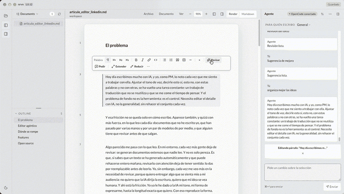
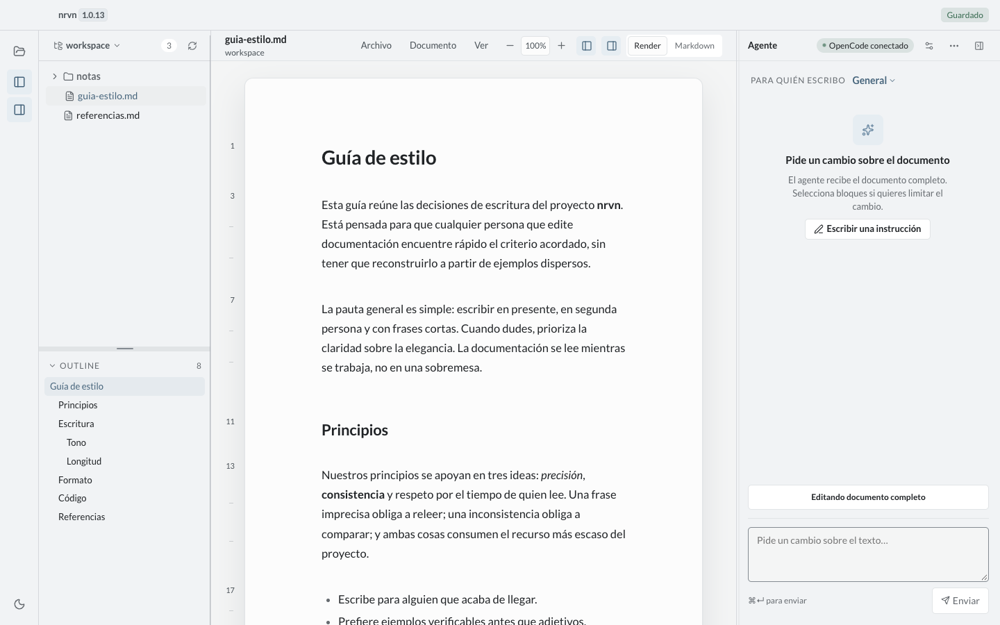
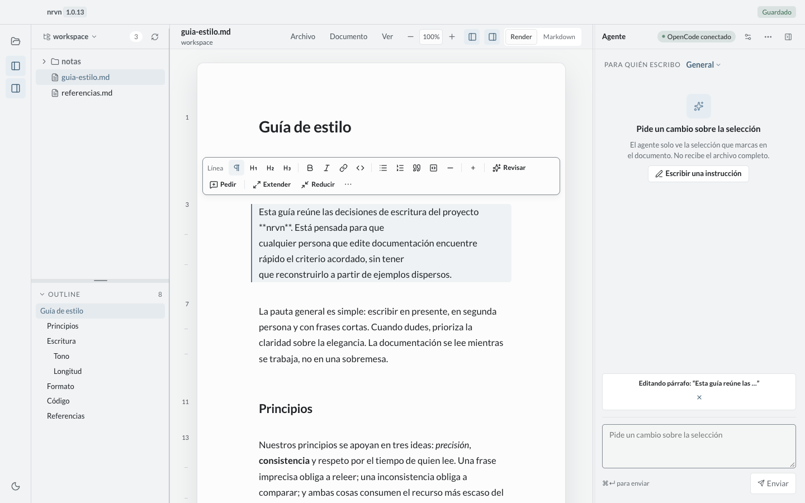
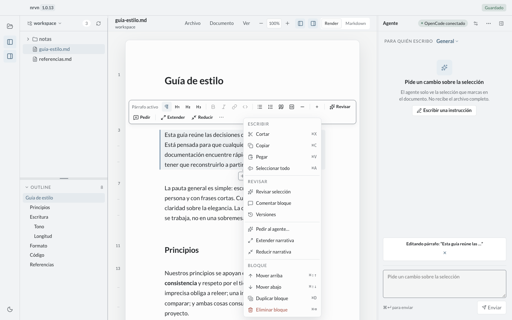
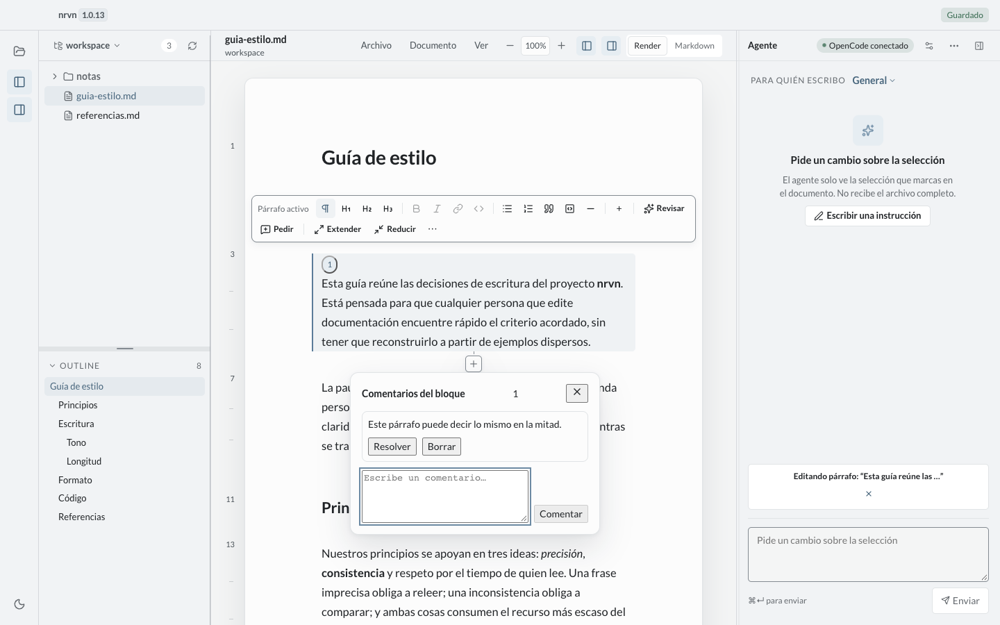
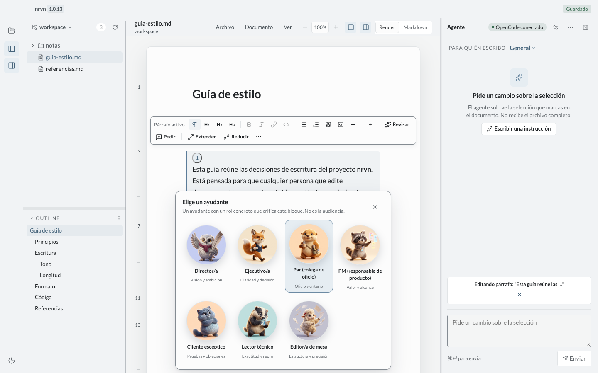
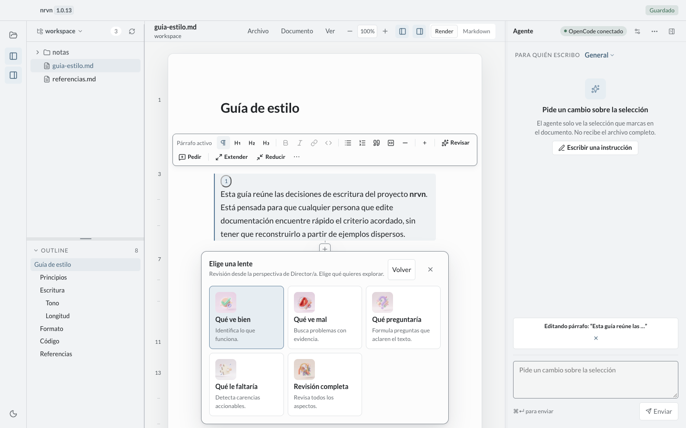
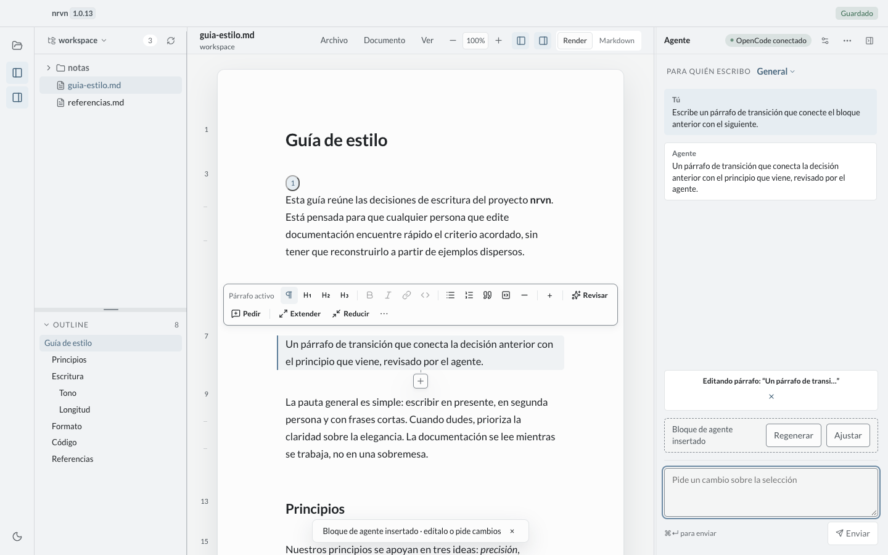
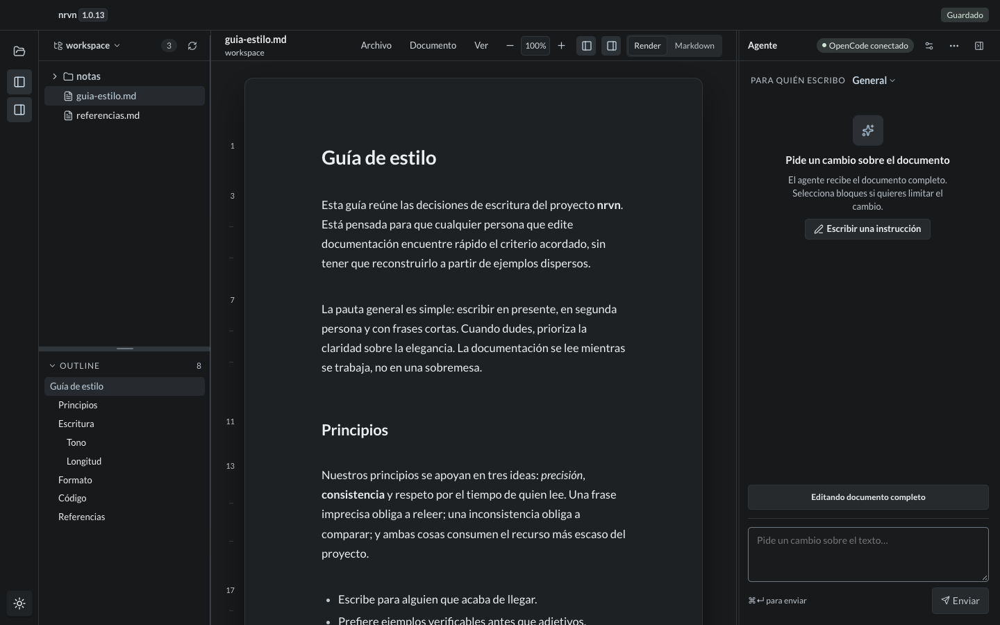

# nrvn

[English](README.md) | [Español](README.es.md)

Local Markdown editor with agents, for macOS.

Open a folder, read your documents with editorial typography, select a block, and ask an agent
to rewrite it. The agent **proposes**; you decide. Nothing is applied automatically and nothing
leaves your machine except the request to the model provider you chose.

<p align="center">
  
</p>

> **Status: v1.0.13, 2026-11-05.** The current app includes Render/Markdown editing,
> block/section/range selection, OpenCode agent proposals with diffs, inline Render operations,
> comments and critiques, language copies, themes, and `.nrvn` metadata export/import. This is a
> macOS Apple Silicon release candidate, not a claim that every roadmap item is complete. Apple
> signing/notarization, Windows/Linux, auto-update, complete UI i18n, a formal AA audit and sync
> remain out of scope for this candidate. See [Honesty](#honesty).

## Purpose and vision

`nrvn` exists because of a real problem for PMs and writers who draft documents with AI: today's
tools are either loose chat or editors that rewrite everything. What is missing is an editor
that lets you **iterate on a document in parts, preserving voice and context**, and turn
repeated corrections into reusable rules.

But the vision is not "writing faster". It is **being able to review without giving up**: an
AI-assisted document must remain readable, arguable and defensible as your own. nrvn exists to
reduce the friction of reviewing and preserve human decisions, not to produce dumps of generated
content. The full positioning is in [`docs/editor-agentico.en.md`](docs/editor-agentico.en.md)
([Español](docs/editor-agentico.md)); priorities are in [`ROADMAP.en.md`](ROADMAP.en.md)
([Español](ROADMAP.md)).

The product intent rests on a few principles. They describe the vision, not the current state:
built and pending work are separated in [Honesty](#honesty).

- **Isolated iteration.** You work on a block, a section or a range. The agent receives only
  that selection and can only touch it. The whole document is sent only when you explicitly
  select it.
- **Persistent voice and tone.** Each workspace/document has a voice profile (register, person,
  length, lexicon, things to avoid, examples) that the agent uses as style context, kept
  separate from content.
- **Area memory.** Each block or section stores human decisions, instructions and the "why it is
  like this"; that memory travels with the area and survives the next edit.
- **Provenance.** Knowing what a person wrote, what an agent generated and what was accepted is
  part of the document; human authorship is never simulated.
- **Focus sessions.** You can focus on one area (e.g. "Introduction") for a while, iterate until
  it is good, and close it. The history stays attached to that block or section.
- **Guidelines inbox.** Every useful instruction ("no adverbs", "sentences of 20 words max") is
  captured. Once there are enough, they are **summarized into a rules block** and can be applied
  to the whole document.
- **Consistency refactor.** Applying consolidated rules to blocks that were not edited by hand,
  always as proposals with a diff, never automatically.
- **Versioning (roadmap).** Per-block and document version history are not implemented.
- **Anchored comments.** Review by element, with threads and resolution.
- **Local-first and control.** Files on disk, metadata in Application Support, proposals you
  accept, an agent with no tools.

## Honesty

- **A personal tool, open source, 100% built with AI.** nrvn is not a company product and has
  no support. It is a tool its author needs, published under the MIT license for
  anyone who wants to use, audit or improve it. That warning is explicit: the code and docs were
  produced with AI and must be read as such.
- **AI accelerates, but it can erode trust and authorship.** nrvn exists to keep human control of
  the narrative, not to surrender it or to produce documents nobody reads.
- **It does not remove bias or guarantee quality.** It reduces friction and preserves decisions;
  the final review remains human.
- **Shipped is not vision.** Today there is an editor, selection, an agent, proposals and
  connectors. Area memory, human edit lock, related conceptual context, multi-source generation,
  exportable provenance and risk review are vision, not state. The honest detail is in
  [`docs/editor-agentico.en.md#5-honesty-and-limits`](docs/editor-agentico.en.md#5-honesty-and-limits).

## The article

**[The agentic editor](docs/editor-agentico.en.md)** ([versión en español](docs/editor-agentico.md))
is the long-form piece behind nrvn: why writing with AI fails on control rather than on quality,
what an agent actually needs to become a writing partner, and where the current build still breaks.

> These days we write a lot with AI. Adjusting tone, saying yes to this and no to that, is
> translation work that doesn't get reused and eats the time I have to think. The problem isn't
> the tool: it's control — editing the detail without redoing the whole thing every time.
>
> The AI reproduces my form. But form isn't the idea: it writes like me and still doesn't say what
> I wanted, because it doesn't have the decision context behind each paragraph.

The article also explains the model the editor is built on: the document as a tree of nodes, context
stored per block, the agent receiving only the selected node, and human edits that survive the next
iteration.

## The problem

- **Tool friction.** Markdown editors that read well edit badly, and editors that edit well force
  a code view that breaks reading.
- **Invasive AI assistants.** Most AI writing tools work at whole-document or loose-chat level:
  you copy and paste, lose track of *what* you are rewriting, and get no granular control.
- **Lost context.** Conversations about a document are not attached to it; reopening the file
  starts from zero.
- **Lost voice.** Regenerating a whole document flattens the author's register and the decisions
  already made.
- **Orphan annotations.** Comments and reviews live elsewhere, or as sidecar files that pollute
  the user's repository.

## Who it is for

| Segment | Description | Dominant need |
| --- | --- | --- |
| **PM / writer drafting with AI** | Writes briefs, PRDs, interviews and essays in Markdown. | Improve drafting by parts without losing voice or control. |
| **Technical editor** | Writes docs, RFCs and architecture notes inside a local repo. | Rewrite sections precisely without breaking format or history. |
| **Reviewer** | Reviews another person's document and leaves anchored feedback. | Comment per element with threads and resolution. |
| **OpenCode user** | Already has models configured. | An editing surface that reuses that configuration. |

## The three-step flow

```
1. SELECT                2. ASK                      3. ACCEPT
┌──────────────────┐     ┌──────────────────┐       ┌──────────────────┐
│ click a paragraph│     │ "more concise,   │       │ before/after diff │
│ click a heading  │ ──▶ │  keep the 40%"   │ ────▶ │ Accept            │
│ Shift + click    │     │ Cmd+Enter        │       │ Reject            │
└──────────────────┘     └──────────────────┘       │ Ask for changes   │
                                                     └──────────────────┘
```

1. **Select.** Clicking a paragraph selects that block. Clicking a heading selects the whole
   section up to the next heading of the same or higher level. Shift + click extends to a
   contiguous range. Esc clears. *(Implemented.)*
2. **Ask.** The right panel works on the selection or on the whole document when you explicitly
   ask for it: it receives the file, the heading path and the context text, nothing else. The
   context chip shows whether you are working on `Whole document` or on a selection.
   *(Implemented and in validation.)*
3. **Accept.** The response is parsed and shown as a per-block diff or as a document proposal.
   Accepting applies exactly that replacement; rejecting leaves the document untouched.
   *(In validation: the whole-document contract has not been tested with a real agent yet.)*

## Core concepts

| Concept | What it is | Status |
| --- | --- | --- |
| **Selection** | Block, section, contiguous range, or the whole document explicitly selected. The unit of work. | Implemented |
| **Area memory** | Decisions and instructions stored per block or section, with their "why". | Vision (EA roadmap) |
| **Voice profile** | Per-document style context: register, person, length, lexicon, avoid list, examples. | Planned v0.2 |
| **Focus session** | A time-boxed area of work ("Introduction") with its own history. | Planned v0.2 |
| **Guidelines inbox** | Captured instructions that become a summarized rules block. | Not implemented |
| **Version** | Navigable per-block history with provenance and restore-as-new-version. | Pending |
| **Proposal** | A diff the user accepts, rejects or asks to change. Never auto-applied. | In validation |

## Features: current vs roadmap

| Area | Current (v1.0.13) | Not included / later |
| --- | --- | --- | --- | --- |
| Shell and workspace | Electron app, tree and outline, About | — | Git integration | Windows/Linux |
| Editor | Render/Markdown, autosave, inline editing, format/insert/block operations | — | — | — |
| Agent and review | OpenCode embedded/local/OAuth, proposals and diffs, presets, audiences/personas, critiques, annotated comments, variant from review | Free variants by axes are roadmap | — | — |
| Document metadata | `.nrvn` sidecar `<doc>.md.nrvn`, import/export; language copies | — | — | Sync |
| Appearance | Light/dark, Lato/Newsreader/system, Letter/A4/Wide/Web | — | — | Formal AA audit |
| Platform | macOS arm64; installer script | — | — | Apple signing/notarization, auto-update |

## Feature tour

Real UI, v1.0.13 (mock dataset). The recording at the top shows the loop end to end: open a
document, select a block, ask the agent, review the result. Full-size files in
[`docs/assets/screenshots/v113/`](docs/assets/screenshots/v113/).

<table>
  <tr>
    <td width="50%"><br><strong>Editor, tree and agent.</strong> Render view with editorial typography, outline, and the agent panel waiting for a selection.</td>
    <td width="50%"><br><strong>Block-level selection.</strong> The agent receives only the selected block, its heading path and its context — never the whole file unless you ask.</td>
  </tr>
  <tr>
    <td><br><strong>Block menu.</strong> Format, ask the agent, extend or reduce the narrative, review, comment or move the block without touching the rest.</td>
    <td><br><strong>Anchored comments.</strong> Threads live on the block, with resolve and delete, and a badge in the gutter.</td>
  </tr>
  <tr>
    <td><br><strong>Review by audience.</strong> Seven personas read the block from a role: director, exec, peer, PM, skeptical client, technical reader, editor.</td>
    <td><br><strong>Review lenses.</strong> Each persona applies five lenses: what works, what fails, what it would ask, what is missing, full review.</td>
  </tr>
  <tr>
    <td><br><strong>Agent block.</strong> A generated block you can regenerate or adjust; the document keeps its structure and the rest of the text stays untouched.</td>
    <td><br><strong>Dark theme.</strong> Same document, same controls, light or dark.</td>
  </tr>
</table>

## Design system

The code today ships **v3 "Moon Silver / Pearl Grey"**: a cooler, softer neutral palette with
**Lato** for all UI and prose, replacing the serif Newsreader. Full detail is in
[`docs/design-system.md`](docs/design-system.md).

- Light: Mist `#F4F5F5` background, `#FCFCFC` surface, Moon Silver `#ECEEEF` sunken,
  ink `#202326`, accent `#6C8AA3`, accent-text `#46647B`.
- Dark: `#191B1D` background, `#202326` surface, ink `#ECEEF0`, accent `#A9C0D2`.
- Lato 400/700 (+ 400 italic), UI 12/13/14 px, prose 16.5 px / 1.7, headings 600, system mono.
- Radii 5/8/12; shadows `0 1px 2px rgba(16,24,40,.04)` and `0 12px 32px rgba(16,24,40,.12)`;
  motion 120/180 ms; 2 px accent focus ring with 2 px offset; no gradients, no glassmorphism.

## Architecture

| Piece | Choice |
| --- | --- |
| Shell | Electron 45 |
| UI | React 19 + TypeScript |
| Build | Vite |
| Packaging | electron-builder (`.app` / `.dmg`, macOS arm64) |
| Agent | `@opencode/sdk` embedded in the main process; local connector and OAuth device |
| Editor | CodeMirror 6 |
| Render | react-markdown + remark-gfm + Shiki |
| State | Zustand |
| Accessible menus | Radix DropdownMenu 2.2.1 + ContextMenu 2.4.1 |
| Icons | lucide |
| Diff | jsdiff |
| Tests | Vitest + Playwright |
| Lint/format | Biome |

In one sentence: the **main process** owns disk, native dialogs and the native menu; the
**renderer** owns the UI and the block model; between them there is a **typed IPC bridge** over
`contextBridge`, with no `nodeIntegration` and no direct `ipcRenderer` access.

Two decisions explain the rest:

1. **The agent will have no tools.** It runs as a dedicated agent (`nrvn-editor`) with every tool
   denied and the user's MCP servers disabled in that instance. It is a text generator, not an
   executor.
2. **Portable metadata and local cache.** Portable metadata lives in `<document>.md.nrvn`, next to
   the `.md`; Application Support stores working-state cache (`threads.json`, `annotations.json`,
   `pending.json`). The `.md` itself is never modified by metadata.

The full detail — block model, marker contract, persistence, risks and roadmap — is in
[`BRD.md`](BRD.md) ([English](BRD.en.md)).

## Requirements

- macOS 13 or later, Apple Silicon (arm64). The only platform packaged in v1.
- Node.js 22 or later and npm for development.
- Model provider credentials configured for OpenCode if you want the real agent. Without them the
  app still works as a Markdown editor, and mock mode covers the UI flow.

## Development

```bash
npm install        # install dependencies
npm run dev        # app in development with HMR
npm run mock       # app with VITE_MOCK_BRIDGE=1: simulated agent, no network or credits
npm run typecheck  # TypeScript without emitting
npm run lint       # Biome
npm run test:unit  # unit tests (Vitest)
npm run test:perf  # isolated 200 KB benchmark in tests/perf/
npm run test:e2e   # Playwright (specs)
npm run build      # build + packages .app/.dmg (bumps patch)
npm run dist       # same: build + packages .app/.dmg (bumps patch)
```

`npm run build` and `npm run dist` both build and package into `release/`. The prebuild/predist hooks increment the patch in package.json and package-lock.json. Skip this with `NRVN_SKIP_VERSION_BUMP=1 npm run build` (or `npm run dist`).

**Verified at v1.0.6:**

| Command | Status |
| --- | --- |
| `npm install` | ✅ |
| `npm run dev` | ✅ |
| `npm run mock` | ✅ |
| `npm run typecheck` | ✅ |
| `npm run lint` | ✅ (no errors) |
| `npm run test:unit` | ✅ |
| `npm run test:e2e` | ✅ |
| `npm run build` | ✅ |
| `npm run dist` | Executed at cycle close; result recorded there |

Notes:

- `npm run mock` is the recommended way to explore the product and run Playwright: no
  credentials, no credits.
- `npm run dist` produces artifacts without Apple signing; macOS may require manual Gatekeeper authorization.
- The Playwright smoke test runs against the mock build.

## Project status

**v1.0.6, 2026-11-04.** The macOS app includes Render/Markdown editors,
selection, tree and outline, Radix menus, embedded/local OpenCode and OAuth, diff proposals,
inline formatting/editing/insertion and block operations, presets, audiences/personas,
critiques, anchored comments, variant from review, `.nrvn` metadata import/export, language copies, themes and the
`scripts/install-app.sh` installer.

What this means in practice:

- There is no signed or notarized downloadable release.
- Apple signing/notarization, Windows/Linux packages, auto-update, complete UI i18n, formal AA audit
  and sync are **not available**.
- Free variants by axes are roadmap. Per-block and document version history are not implemented;
  anchored comments are implemented. Guidelines/rules, consistency refactor, conceptual context and
  multi-source generation remain outside this candidate unless separately verified as shipped.
- No benchmarks are published; the BRD metrics are targets, not results.
- The authorship and review vision is in [`docs/editor-agentico.en.md`](docs/editor-agentico.en.md);
  priorities and acceptance signals are in [`ROADMAP.en.md`](ROADMAP.en.md).

## Folder structure

```
nrvn/
├── BRD.md                  # living product definition (Spanish)
├── BRD.en.md               # English translation
├── README.md               # this file
├── README.es.md            # Spanish translation
├── LICENSE
├── package.json
├── scripts/
│   ├── bump-version.mjs
│   └── install-app.sh
├── electron-builder.yml
├── docs/
│   ├── editor-agentico.en.md # authorship and product positioning (English)
│   ├── editor-agentico.md  # Spanish version
│   ├── design-system.md    # v3 design system (English)
│   └── design-system.es.md # v3 design system (Spanish)
├── electron/
│   ├── main.ts             # lifecycle, window, titlebar
│   ├── menu.ts             # native menu template (pure function)
│   ├── ipc.ts              # typed handlers
│   ├── preload.ts          # contextBridge: window.nrvn
│   ├── lib/                # atomic, tree, paths, logger
│   └── services/           # workspace, settings, opencode
├── src/
│   ├── components/
│   │   ├── layout/         # AppShell, TitleBar, HeaderBar, Rail
│   │   ├── tree/           # TreePanel, TreeRow, OutlinePanel
│   │   ├── render/         # RenderArticle, MarkdownBlock, CodeBlock
│   │   ├── editor/         # CodeMirror 6
│   │   ├── document/       # DocumentView, EmptyDocument
│   │   ├── agent/          # agent panel
│   │   └── ui/             # menu.tsx, context-menu.tsx (Radix)
│   ├── lib/                # blocks, sections, ranges, commands, startup, ipc
│   ├── store/              # zustand: workspace, document, ui, selection
│   └── styles/             # tokens.css, global.css, prose.css, menu.css
├── tests/
│   ├── unit/               # Vitest unit coverage
│   └── e2e/                # Playwright specs + screenshots
├── fixtures/               # test documents and mock responses
├── docs/assets/             # versioned screenshots and visual concepts
└── release/                # generated artifacts (not versioned)
```

## Privacy

- **Everything is local.** Documents, threads and metadata stay on your machine. There are no nrvn
  servers: there is no backend.
- **Metadata does not alter Markdown content.** Portable metadata lives in `<document>.md.nrvn`;
  Application Support stores the working-state cache (`threads.json`, `annotations.json`, `pending.json`).
  Metadata never modifies the `.md`.
- **Network access** includes model-provider requests, queries to the OpenCode host's provider/model
  catalog, and the OAuth device flow to `https://opencode.ai/console` when connecting an account.
  There is no nrvn backend or remote telemetry.
- **No remote telemetry** in v1. Metric counters, if enabled, are local.
- **The agent cannot touch files** or run commands: it has no tools.

## Visual references

`docs/assets/design/ui-concept-1.png` and `docs/assets/design/ui-concept-2.png` are **visual
concepts, not product screenshots**. Real screenshots live in
`docs/assets/screenshots/v113/` (`v0.9.0` kept in `docs/assets/screenshots/v090/`). The v3 design sheet
(`docs/assets/design/design-sheet-01.png`) is a generated visual concept, not a product screenshot.

## License and Intellectual Property

nrvn (rights holder: **rainbrth**) is **open source** under the **MIT License**:

- **Free to use, study, modify and redistribute**, including commercially, with no obligation to
  publish your changes or your product's source code. You only need to keep the copyright notice
  and the license text in copies or substantial portions of the software.
- **Full terms:** [`LICENSE`](LICENSE), [`NOTICE`](NOTICE) and [`COPYRIGHT`](COPYRIGHT).
- **No warranty.** The software is provided "as is", without warranty of any kind, as stated in
  the license.
- **Intellectual property** in the original code, documentation, design and original assets
  remains with its respective holders. Third-party components and fonts remain under their own
  licenses; see [`NOTICE`](NOTICE).
- **No legal advice.** These documents have not been validated by counsel.

Bundled fonts are distributed under the SIL Open Font License 1.1. The product uses **Lato**, with
Inter kept only as a system fallback.
